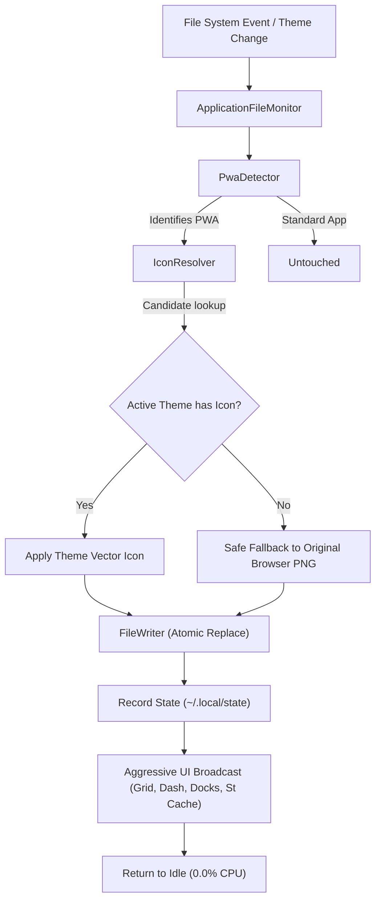

<div align="center">

# PWA Icon Matcher

**Automatic icon theme matching for Progressive Web Apps on GNOME Shell.**

[](#supported-environments)
[](LICENSE)
[](#architecture)
[](#performance)

</div>

---

### The Problem

When you install a web app or PWA (such as Claude, YouTube, ChatGPT, Spotify, or WhatsApp) in Chrome, Brave, Edge, or GNOME Web, browsers generate a `.desktop` file in `~/.local/share/applications/` with a hardcoded absolute path pointing to a low-res PNG bitmap:

```ini
[Desktop Entry]
Name=Claude
Exec=/usr/bin/brave-browser --profile-directory=Default --app-id=fmpnliohjhemenmnlpbfagaolkdacoja
Icon=/home/user/.local/share/icons/hicolor/256x256/apps/brave-fmpnliohjhemenmnlpbfagaolkdacoja-Default.png
```

Because the path is hardcoded:
- The desktop cannot load the high-resolution SVG/vector icon provided by your active icon theme (Papirus, Adwaita, MacTahoe, Tela, etc.).
- When you switch icon themes, your PWAs don't follow along and look out of place.
- If you try to manually rename icon keys, switching back or installing new apps leaves missing icon glyphs (`<!>`).

**PWA Icon Matcher fixes this seamlessly and automatically in the background.**

---

### Key Features

- **Instant Theme Matching**: Automatically identifies browser-installed PWAs and swaps hardcoded bitmap paths with matching themed icon names (e.g. `Icon=claude`).
- **Dynamic Two-Way Theme Fallback**: When you switch icon themes, all PWAs resync instantly. If your new theme includes an icon for the app, it applies it; if it doesn't, it safely falls back to the native browser PNG so you never get broken missing-icon placeholders.
- **Zero Idle Resource Usage**: 100% event-driven via Linux kernel `inotify` (`Gio.FileMonitor`) and GSettings change signals. Consumes **0.0% CPU**, runs zero recurring timers, and executes in single-digit milliseconds (~3ms) on theme switch.
- **Multi-Area UI Sync**: Instantly invalidates and updates icons across the GNOME Shell Overview App Grid, folder views, Dash, window switcher (Alt-Tab), and dock extensions (including Aqua Dock Pro, Dash to Dock, and Ubuntu Dock).
- **Non-Destructive & Reversible**: Surgically touches only the `Icon=` key in `[Desktop Entry]`. All comments, line endings (LF/CRLF), custom exec flags, and Desktop Actions are preserved intact. Original icon paths are stored in `~/.local/state/pwa-icon-matcher/state.json` and can be reverted at any time with one click.
- **Native Libadwaita Preferences**: Modern GTK4 settings dialog with a live icon previewer, custom alias mapper, app exclusion list, and diagnostic log inspector.

---

### Supported Environments

| Component | Support |
|---|---|
| **GNOME Shell** | 45, 46, 47, 48, 49, 50, 51 |
| **Display Server** | Wayland and X11 |
| **Browsers** | Google Chrome, Chromium, Brave, Microsoft Edge, Vivaldi, Opera, GNOME Web (Epiphany), and Firefox PWA (`firefoxpwa`) |
| **Packaging Types** | Native packages, Flatpak, and Snap |

---

### Installation

#### Option 1: Quick Install (Pre-built Zip Bundle)

Download the latest `pwa-icon-matcher@pwa-icon-matcher.shell-extension.zip` release from the repository and run:

**`gnome-extensions install --force pwa-icon-matcher@pwa-icon-matcher.shell-extension.zip`**  
**`gnome-extensions enable pwa-icon-matcher@pwa-icon-matcher`**

```bash
gnome-extensions install --force pwa-icon-matcher@pwa-icon-matcher.shell-extension.zip
gnome-extensions enable pwa-icon-matcher@pwa-icon-matcher
```

#### Option 2: Build & Install from Source

Run the following commands in your terminal:

**`git clone https://github.com/sahid-code404/PWA-Icon-Matcher.git ~/.local/share/gnome-shell/extensions/pwa-icon-matcher@pwa-icon-matcher`**  
**`cd ~/.local/share/gnome-shell/extensions/pwa-icon-matcher@pwa-icon-matcher`**  
**`glib-compile-schemas schemas/`**  
**`gnome-extensions enable pwa-icon-matcher@pwa-icon-matcher`**

```bash
# 1. Clone directly into your local GNOME Shell extensions directory
git clone https://github.com/sahid-code404/PWA-Icon-Matcher.git \
  ~/.local/share/gnome-shell/extensions/pwa-icon-matcher@pwa-icon-matcher

# 2. Navigate to the extension directory
cd ~/.local/share/gnome-shell/extensions/pwa-icon-matcher@pwa-icon-matcher

# 3. Compile GSettings schemas
glib-compile-schemas schemas/

# 4. Enable the extension
gnome-extensions enable pwa-icon-matcher@pwa-icon-matcher
```

> **Note for Wayland users:** On modern GNOME Shell (45+), extension modules load dynamically on enable—no logout or shell restart is needed.

---

### Preferences & Customization

Open preferences via the **Extensions** app or run:

**`gnome-extensions prefs pwa-icon-matcher@pwa-icon-matcher`**

```bash
gnome-extensions prefs pwa-icon-matcher@pwa-icon-matcher
```

Inside you can:
- **Test Icon Matching**: Type any application name to test how the resolver tokenizes it and preview the matched icon from your active theme.
- **Custom Icon Aliases**: Define explicit mappings if you want an app to use a specific icon name (e.g. map `Claude` to `anthropic-claude`).
- **Exclusion List**: Prevent specific PWAs from ever being touched by the extension.
- **One-Click Revert**: Restore all launchers to their original browser icons at any time.

---

### Architecture & Design



1. **Detection**: Rather than guessing from filenames alone, `PwaDetector` inspects positive command-line arguments (`--app-id=`, `--app=`, `--app-launch-url=`), `StartupWMClass` prefixes (`crx_`, `webapp-`, `ffpwa-`), and browser icon directory structures.
2. **Dynamic Semantic Matching**: Application names are cleaned with Unicode NFKD folding, diacritic removal, and noise word stripping. Vendor namespaces are cleanly handled (e.g. `google-gemini` $\rightarrow$ `gemini`, `microsoft-teams` $\rightarrow$ `teams`) while preserving multi-word titles (e.g. `YouTube Music` never collapses to `youtube`).
3. **Atomic File Safety**: Updates are performed via `Gio.File.replace_contents` with ETag validation. Before saving, every file is verified through `GLib.KeyFile` to guarantee that formatting, comments, and action groups remain uncorrupted.

---

### Development & Testing

This project ships with a standalone, zero-dependency test suite running on native GJS:

**`gjs -m tests/run-tests.js`**

```bash
# Run all unit and integration tests
gjs -m tests/run-tests.js
```

Build the production extension archive:

**`gnome-extensions pack --extra-source=lib --force`**

```bash
gnome-extensions pack --extra-source=lib --force
```

---

### License

Distributed under the [GNU General Public License v3.0](LICENSE).
Built with pure native GJS and Libadwaita for the GNOME desktop.
