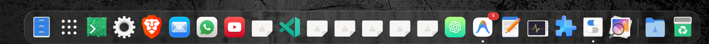
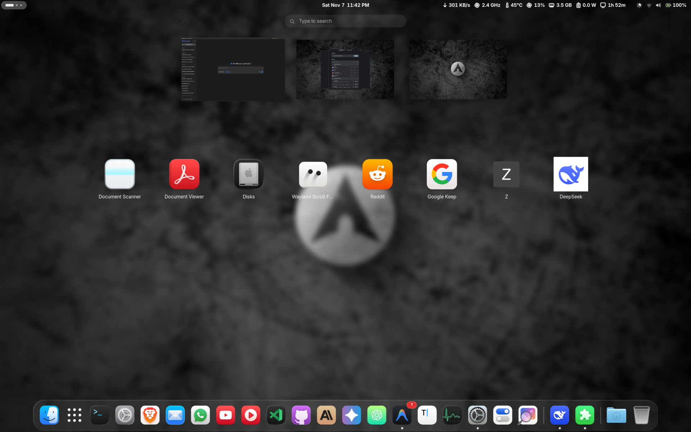

<div align="center">

# PWA Icon Matcher

Automatic icon theme matching for Progressive Web Apps (PWAs) on GNOME Shell.

[](#compatibility)
[](LICENSE)
[](#what-it-does)

<br/>



</div>

---

### What it does

Browsers hardcode low-resolution bitmap PNGs into `.desktop` files when you install a PWA, breaking your system icon theme.

**PWA Icon Matcher** resolves this automatically:
- **Theme Matching**: Automatically applies matching vector icons from your active icon theme (Papirus, Adwaita, MacTahoe, etc.).
- **Dynamic Fallback**: Switching themes resyncs all icons in <5ms. If the new theme doesn't have an icon, it safely falls back to the native browser icon—no broken `<!>` glyphs.
- **Zero Idle Resources**: 100% event-driven via `Gio.FileMonitor`. Consumes 0.0% CPU at idle.
- **Full Desktop Sync**: Updates the Overview App Grid, Dash, Docks (Aqua Dock Pro, Dash to Dock), and Alt-Tab switcher instantly.
- **Non-Destructive**: Stores original paths in `~/.local/state/pwa-icon-matcher/state.json`. Revert anytime with one click.

<br/>

<div align="center">
  
</div>

---

### Installation

#### Option 1: Quick Install (Pre-built Zip)

```bash
gnome-extensions install --force pwa-icon-matcher@pwa-icon-matcher.shell-extension.zip
gnome-extensions enable pwa-icon-matcher@pwa-icon-matcher
```

#### Option 2: Install from Source

```bash
git clone https://github.com/sahid-code404/PWA-Icon-Matcher.git \
  ~/.local/share/gnome-shell/extensions/pwa-icon-matcher@pwa-icon-matcher

cd ~/.local/share/gnome-shell/extensions/pwa-icon-matcher@pwa-icon-matcher
glib-compile-schemas schemas/
gnome-extensions enable pwa-icon-matcher@pwa-icon-matcher
```

---

### Preferences

Configure custom aliases, exclusions, or test icon lookups:

```bash
gnome-extensions prefs pwa-icon-matcher@pwa-icon-matcher
```

---

### Compatibility

- **GNOME Shell**: 45, 46, 47, 48, 49, 50, 51 (Wayland & X11)
- **Browsers**: Chrome, Chromium, Brave, Edge, Vivaldi, Opera, Epiphany, Firefox PWA (`firefoxpwa`)

---

### Development

Run the test suite:

```bash
gjs -m tests/run-tests.js
```

Build the release archive:

```bash
gnome-extensions pack --extra-source=lib --force
```

---

### License

[GNU General Public License v3.0](LICENSE)
